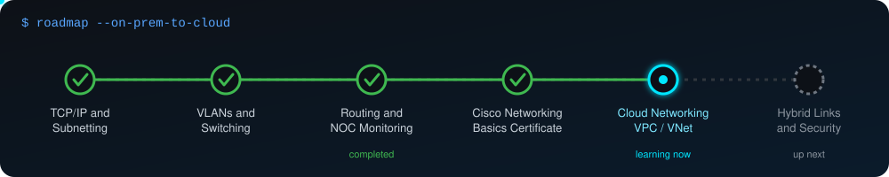

  
   
  
    
  
  
  
  
    
  
  
    
  
    
  

<h2>👨‍💻 About Me</h2>

<pre>
$ whoami
rafan - graduate engineer (B.Tech AI and ML, 2026), growing into a network engineer

$ cat focus.txt
-> Enterprise networking: TCP/IP, IPv4 subnetting (CIDR), VLANs, routing and switching
-> NOC operations: monitoring, alerting, troubleshooting, documentation
-> Cloud networking: building on top of solid on-prem fundamentals

$ status
Open to Junior Network Engineer / NOC Engineer roles in the UAE - available immediately
</pre>

I am a recent <b>B.Tech graduate in Artificial Intelligence and Machine Learning</b> with a strong foundation in <b>computer networking and IT infrastructure</b>. I design small office networks in <b>Cisco Packet Tracer</b>, administer <b>Linux</b> servers, and monitor infrastructure with <b>Prometheus and Grafana</b>. My goal is to apply these skills in an entry-level network or NOC role and grow into <b>enterprise and cloud networking</b>.

<h2>🛠️ Tech Stack</h2>

<h3>🌐 Networking</h3>

<h3>🔧 Tools and Platforms</h3>

<h3>📊 Monitoring</h3>

<h3>💻 Scripting</h3>

<h3>🧰 Diagnostic Commands</h3>
<code>ping</code> · <code>traceroute</code> · <code>ipconfig</code> · <code>nslookup</code> · <code>ip a</code> · <code>ss</code>

<h2>🚀 Featured Projects</h2>

<table>
  <tr>
    <td width="50%" valign="top">
      <h3>🏢 Office Network Design and Implementation</h3>
      
<code>Cisco Packet Tracer</code> <code>Cisco 2911</code> <code>Cisco 2960</code> <code>IPv4</code> <code>VLANs</code>

      <ul>
        <li>Designed a small office topology: workstations, switches, router and server</li>
        <li>Configured static IP addressing and subnet allocation</li>
        <li>Implemented VLANs for network segmentation</li>
        <li>Practised routing, switching and connectivity troubleshooting</li>
      </ul>
    </td>
    <td width="50%" valign="top">
      <h3>🐧 Linux Server Administration and Automation</h3>
      
<code>Ubuntu Linux</code> <code>Bash</code> <code>Python</code>

      <ul>
        <li>Practised Linux user and group management</li>
        <li>Developed Bash scripts for system information, health checks and backups</li>
        <li>Performed basic system administration from the command line</li>
        <li>Practised service management and system troubleshooting</li>
      </ul>
    </td>
  </tr>
  <tr>
    <td colspan="2" valign="top">
      <h3>📊 Infrastructure Monitoring with Prometheus and Grafana</h3>
      
<code>Prometheus</code> <code>Grafana</code> <code>Node Exporter</code> <code>Ubuntu Linux</code>

      <ul>
        <li>Configured Prometheus and Node Exporter for infrastructure monitoring</li>
        <li>Integrated metrics into Grafana dashboards</li>
        <li>Monitored CPU, memory, disk and network performance</li>
        <li>Practised analysing system metrics and infrastructure health</li>
      </ul>
    </td>
  </tr>
</table>

<h2>🧭 Roadmap: On-Prem to Cloud Networking</h2>

  

<h2>🏅 Certifications and Education</h2>

<table>
  <tr><th></th><th align="left">Detail</th><th align="left">When</th></tr>
  <tr><td>📜</td><td><b>Networking Basics</b> - Cisco Networking Academy</td><td>November 2026</td></tr>
  <tr><td>📜</td><td><b>Network Fundamentals</b> - BlueTeamers</td><td>November 2026</td></tr>
  <tr><td>🎓</td><td><b>B.Tech, Artificial Intelligence and Machine Learning</b> - Manakula Vinayagar Institute of Technology, Puducherry</td><td>2022 - 2026</td></tr>
</table>

<b>Languages:</b> English (Professional) · Tamil (Native) · Arabic (Elementary) 
<b>Soft skills:</b> Analytical Thinking · Problem Solving · Communication · Teamwork · Adaptability · Continuous Learning

   
  
  
    
  

