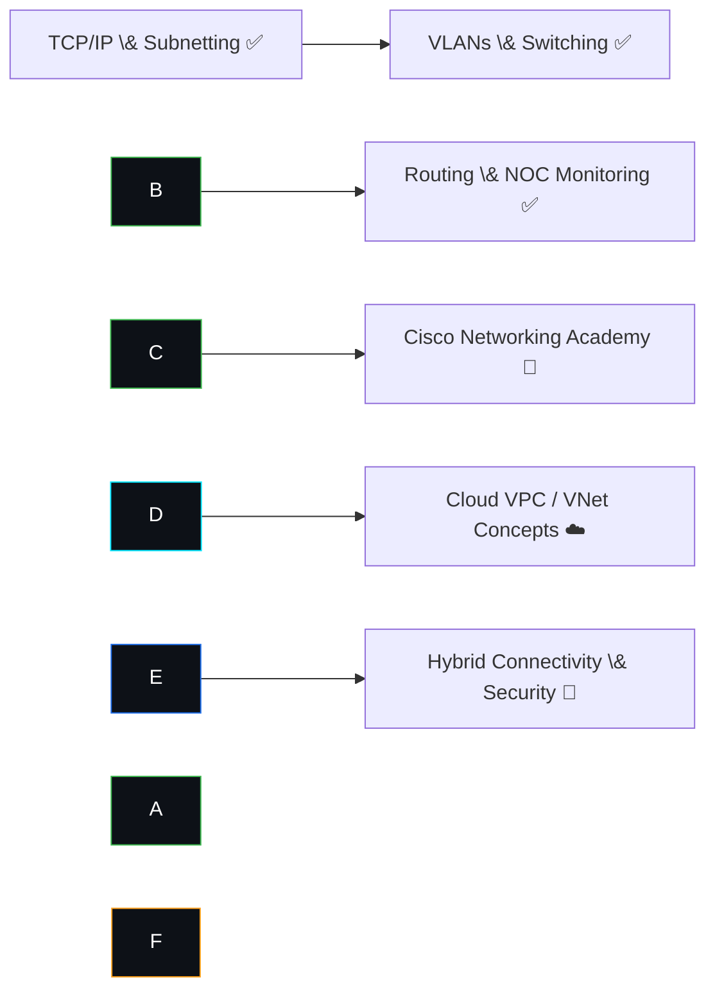

<!-- ═══════════ HEADER ═══════════ -->

<div align="center">


<a href="https://git.io/typing-svg">
  
</a>

<br/>


<br/><br/>

<a href="https://www.linkedin.com/in/rafan-rahuf-ab450636b"></a>
<a href="mailto:rafanrahuf@gmail.com"></a>


</div>

<br/>

<!-- ═══════════ LIVE TOPOLOGY ═══════════ -->

<div align="center">
  
</div>

\---

## 👨‍💻 About Me

```text
$ whoami
rafan — graduate engineer (B.Tech AI \& ML, 2026) turning into a network engineer

$ cat focus.txt
→ Enterprise networking: TCP/IP, IPv4 subnetting (CIDR), VLANs, routing \& switching
→ NOC operations: monitoring, alerting, troubleshooting, documentation
→ Cloud networking: building on top of solid on-prem fundamentals

$ status
Open to Junior Network Engineer / NOC Engineer roles in the UAE — available immediately
```

I'm a recent **B.Tech graduate in Artificial Intelligence and Machine Learning** with a strong foundation in **computer networking and IT infrastructure**. I design small office networks in **Cisco Packet Tracer**, administer **Linux** servers, and monitor infrastructure with **Prometheus \& Grafana**. My goal is to apply these skills in an entry-level network or NOC role and grow into **enterprise and cloud networking**.

\---

## 🛠️ Tech Stack

<div align="center">

### 🌐 Networking


### 🔧 Tools \& Platforms


### 📊 Monitoring


### 💻 Scripting


### 🧰 Diagnostic Commands

`ping` · `traceroute` · `ipconfig` · `nslookup` · `ip a` · `ss` · `tcpdump`

</div>

\---

## 🚀 Featured Projects

<table>
<tr>
<td width="50%" valign="top">

### 🏢 Office Network Design \& Implementation

`Cisco Packet Tracer` `Cisco 2911` `Cisco 2960` `IPv4` `VLANs`

* Designed a small office topology: workstations, switches, router, server
* Configured static IP addressing and subnet allocation
* Implemented VLANs for network segmentation
* Practised routing, switching and connectivity troubleshooting

</td>
<td width="50%" valign="top">

### 🐧 Linux Server Administration \& Automation

`Ubuntu` `Bash` `Python`

* Linux user and group management
* Bash scripts for system info, health checks and backups
* Command-line administration and service management
* System troubleshooting practice

</td>
</tr>
<tr>
<td colspan="2" valign="top">

### 📊 Infrastructure Monitoring with Prometheus \& Grafana

`Prometheus` `Grafana` `Node Exporter` `Ubuntu`

* Configured Prometheus and Node Exporter for infrastructure monitoring
* Built Grafana dashboards for CPU, memory, disk and network performance
* Practised analysing metrics and monitoring infrastructure health

</td>
</tr>
</table>

\---

## 🧭 Roadmap: On-Prem → Cloud Networking



\---

## 🏅 Certifications \& Education

|🎓|Detail|When|
|-|-|-|
|📜|**Networking Basics** — Cisco Networking Academy|Nov 2026|
|📜|**Network Fundamentals** — BlueTeamers|Nov 2026|
|🎓|**B.Tech, Artificial Intelligence \& Machine Learning** — Manakula Vinayagar Institute of Technology, Puducherry|2022 – 2026|

**Languages:** English (Professional) · Tamil (Native) · Arabic (Elementary)
**Soft skills:** Analytical Thinking · Problem Solving · Communication · Teamwork · Adaptability · Continuous Learning

\---

## 📈 GitHub Stats

<div align="center">


<br/>


<br/>


</div>

### 🐍 Contribution Snake

<div align="center">
  <picture>
    <source media="(prefers-color-scheme: dark)" srcset="https://raw.githubusercontent.com/rafan-coder/rafan-coder/output/github-snake-dark.svg">
    <source media="(prefers-color-scheme: light)" srcset="https://raw.githubusercontent.com/rafan-coder/rafan-coder/output/github-snake.svg">
    
  </picture>
</div>

\---

## 🤝 Let's Connect

<div align="center">

I'm looking for a **Junior Network Engineer / NOC Engineer** opportunity in the UAE.
If your team needs someone who is hungry to learn, quick to troubleshoot and ready to start immediately, let's talk.

<a href="https://www.linkedin.com/in/rafan-rahuf-ab450636b"></a>
<a href="mailto:rafanrahuf@gmail.com"></a>

<br/><br/>


</div>

